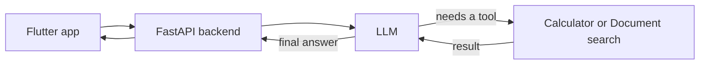

# Mini AI Agent

A chat assistant that answers company policy questions. It can search company documents and do calculations. It has a Flutter phone app, a FastAPI backend, and an LLM (Groq) as its "brain".

## How it works

1. You type a question in the app. It is sent to the backend.
2. The backend sends the question, the last 10 chat messages (from a SQLite database), and a list of available tools to the LLM.
3. The LLM decides what to do. If the question is about company information, it asks for the **document search** tool. If it needs math, it asks for the **calculator** tool. If it needs neither, it just answers.
4. The LLM cannot run tools itself. It only asks. My code runs the tool and sends the result back to the LLM.
5. This repeats (max 5 times) until the LLM has enough information. Then it writes the final answer, which goes back to the app.

**Example:** "What is the meal allowance for 5 days of travel?"
The LLM searches the documents and finds PKR 2,500 per day. Then it uses the calculator for 2500 × 5. Final answer: PKR 12,500.

## Key ideas

- **RAG (document search):** The text files in `docs/` are split into small chunks. Each chunk is turned into a list of numbers (an embedding) that represents its meaning. The question is turned into numbers the same way. Cosine similarity finds the 3 chunks closest in meaning, and those are given to the LLM to answer from.
- **Calculator:** Reads only numbers and + - * / **, so it is safe (no `eval()`).
- **Temperature (0.2):** Low, so answers stay factual and consistent.
- **Tokens:** The backend returns input and output token counts for each request, which shows the cost.

## Run it

1. `cd mini_agent/backend`
2. `python -m venv venv` then `venv\Scripts\activate`
3. `pip install -r requirements.txt`
4. Create a `.env` file with `API_KEY`, `BASE_URL`, `MODEL`
5. `uvicorn main:app --host 0.0.0.0 --port 8000 --reload`
6. Run the Flutter app from Android Studio (set `baseUrl` in `lib/main.dart` to your PC's IP)

## Notes

- Uses Groq's free API (`openai/gpt-oss-120b`) because a paid Claude plan was not available. Switching to the Claude API later means changing only the `.env` settings (and the client).
- The document in `docs/` is fictional sample data.

- Screenshots of the mini agent working
- https://drive.google.com/drive/folders/1LnhvFfylKXw3oxULB2f9pdhd2MukcIOR?usp=sharing
